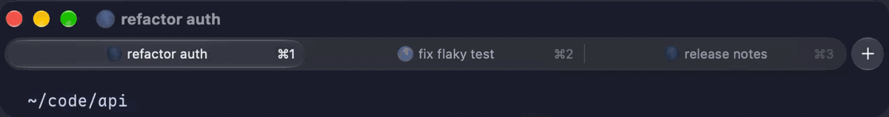
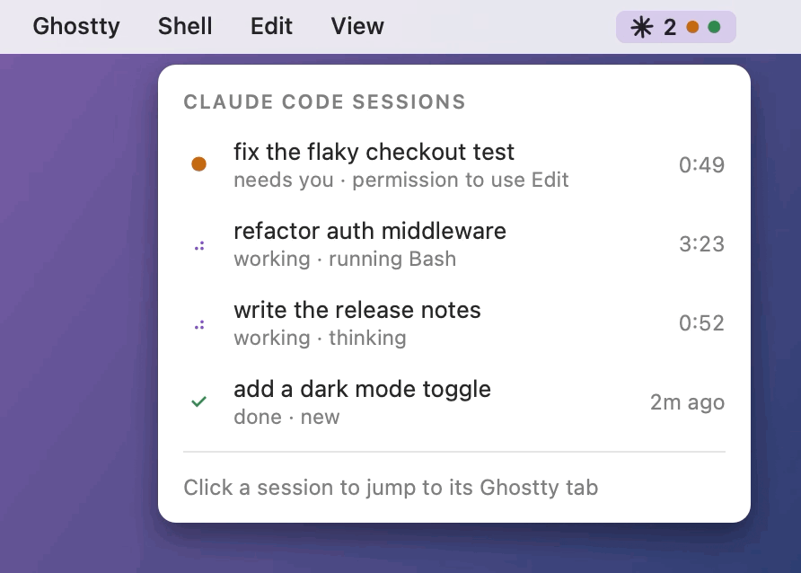
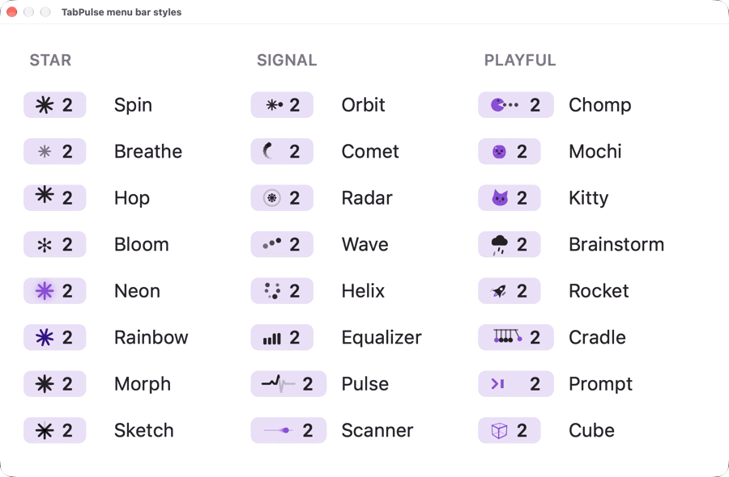

<div align="center">

# TabPulse

See which Claude Code sessions are working, waiting on you or done, right on your Ghostty tabs and in your macOS menu bar.



[](https://github.com/imtripleq/tabpulse/actions/workflows/ci.yml)
[](https://github.com/imtripleq/tabpulse/releases/latest)

[](LICENSE)

</div>

Claude Code only animates the tab you're looking at, so from any other tab a busy session looks idle. TabPulse puts a spinner on every working tab, a ● on any tab that needs you, and a session count in the menu bar.

If it saves you some tab hopping, a star helps other people find it.

## Install

```sh
curl -fsSL https://raw.githubusercontent.com/imtripleq/tabpulse/main/install.sh | bash
```

When macOS asks whether TabPulse may control Ghostty, click OK. Then start `claude` and look for ✳ in your menu bar. Sessions that were already open need a restart.

You need macOS 14 or newer, Claude Code 2.1.78 or newer, and Ghostty 1.4 or newer for the tab spinners. The menu bar works with any terminal. On macOS 14, also run `brew install jq`. There are [other ways to install](#other-ways-to-install) too.

## What you get

<div align="center">
<picture>
  <source media="(prefers-color-scheme: dark)" srcset="assets/menu-dark.gif">
  
</picture>
</div>

- A spinner on every working Ghostty tab, and ● on tabs waiting for you.
- A menu bar count of working sessions. An orange dot means one needs you. A green dot means one finished while you were elsewhere.
- A list of your sessions showing what each one is doing and for how long. Click one to jump to its Ghostty tab.
- A notification when a session finishes, unless you're already looking at its tab.
- No network calls. Everything stays on your Mac.

## Styles

<div align="center">
<picture>
  <source media="(prefers-color-scheme: dark)" srcset="assets/styles-dark.gif">
  
</picture>
</div>

Open the TabPulse menu and pick a look under **Style**. There are 24 menu bar animations (above) and 16 tab spinners:

| Glyph | | Emoji | |
|---|---|---|---|
| Braille (default) | `⠋ ⠙ ⠹ ⠸` | Moon | 🌑 🌒 🌓 🌔 |
| Bounce | `⠁ ⠂ ⠄ ⡀` | Garden | 🌱 🌿 🌷 🌻 |
| Arc | `◜ ◠ ◝ ◞` | Heartbeat | 💜 💖 |
| Equalizer | `▁ ▃ ▅ ▇` | Magic | 🎩 🪄 💫 🐰 |
| Sparkle | `· ✢ ✳ ✶` | Monkeys | 🙊 🙈 🙉 |
| Sine | `⠊⠑⢄ ⠉⠢⣀` | Duck | 💡 🦆 💬 |
| Typing | `⡀⡀⡀ ⠄⡀⡀` | Hatch | 🥚 🐣 🐥 🐤 |
| Snake | `▘ ▀ ▜ ▟` | Slots | 🍒 🔔 🍋 💎 |

TabPulse respects Reduce Motion. To see every menu bar style at once, run `~/Applications/TabPulse.app/Contents/MacOS/TabPulse --style-gallery`.

## How it works

```
Claude Code ── hooks ──▶ tabpulse-hook.sh ──▶ ~/.claude/tabpulse/sessions/<id>.json
                                                        │
                                                        ▼ once a second
                         menu bar + session list ◀── TabPulse.app ──▶ Ghostty tab titles (AppleScript)
```

A small hook script writes each session's state to a JSON file. It prints nothing and always exits 0, so it can't block or change a session. TabPulse reads those files once a second, updates the menu bar and sets the Ghostty tab titles.

## Uninstall

```sh
curl -fsSL https://raw.githubusercontent.com/imtripleq/tabpulse/main/uninstall.sh | bash
```

This removes TabPulse's hooks from `settings.json` (after saving a backup), then the app, the login item and its files. If you used the plugin, also run `/plugin uninstall tabpulse@tabpulse`.

## Other ways to install

### Claude Code plugin

Use this if you don't want the installer to touch `settings.json`. Install only the app:

```sh
curl -fsSL https://raw.githubusercontent.com/imtripleq/tabpulse/main/install.sh | bash -s -- --app-only
```

Then, inside Claude Code:

```
/plugin marketplace add imtripleq/tabpulse
/plugin install tabpulse@tabpulse
```

Already installed the normal way? Add the plugin, then run the installer again without `--app-only`. It removes the old hooks so they don't run twice.

### With CLAUDE_CONFIG_DIR

The installer uses `$CLAUDE_CONFIG_DIR` when it is set. If you only set it inside an alias, run the installer (and later the uninstaller) once for each config dir:

```sh
curl -fsSL https://raw.githubusercontent.com/imtripleq/tabpulse/main/install.sh | CLAUDE_CONFIG_DIR=~/.claude-work bash
```

### Installing the zip by hand

TabPulse isn't notarized, so macOS blocks a copy downloaded in a browser.

1. Unzip `TabPulse.zip` from [Releases](https://github.com/imtripleq/tabpulse/releases/latest) and move `TabPulse.app` to `~/Applications`.
2. Run `xattr -dr com.apple.quarantine ~/Applications/TabPulse.app`.
3. Add the hooks with the plugin commands above.

Installed this way, it doesn't start at login. Add it in System Settings > General > Login Items.

### From source

```sh
git clone https://github.com/imtripleq/tabpulse && cd tabpulse && ./install.sh
```

Building needs the Xcode Command Line Tools (`xcode-select --install`).

## Troubleshooting

**No tab spinner.** Claude has to run directly in a Ghostty tab, not inside tmux, screen or zellij. The menu bar still works there.

**The menu asks to allow TabPulse to control Ghostty.** Click it, or turn on Ghostty under TabPulse in System Settings > Privacy & Security > Automation.

**A session doesn't show up.** Restart it so it picks up the hooks.

**No notification.** Check System Settings > Notifications > TabPulse and your Focus mode. TabPulse waits about ten seconds after a turn ends, and skips the tab you're looking at and turns you stopped yourself.

**Still "working" after Esc.** It catches up within about ten seconds in Ghostty, or about a minute in other terminals.

**Still "needs you" after rejecting a permission.** It clears when Claude Code goes idle, about a minute later.

**The banner says Script Editor.** macOS blocked TabPulse's own notifications, so it sent the banner through AppleScript instead.

**macOS asks for permission again after an update.** Builds aren't notarized yet, so macOS treats each version as a new app.

**Where is Quit?** Hold ⌥ (Option) and click the menu bar icon.

## Contributing

Bug reports, pull requests and new styles are welcome. Help is especially wanted with tab spinners for other terminals (iTerm2, WezTerm, kitty, Terminal.app), notarized builds and a Homebrew cask. [CONTRIBUTING.md](CONTRIBUTING.md) covers setup and tests.

## License

[MIT](LICENSE). TabPulse is a community project and is not affiliated with Anthropic or Ghostty.
