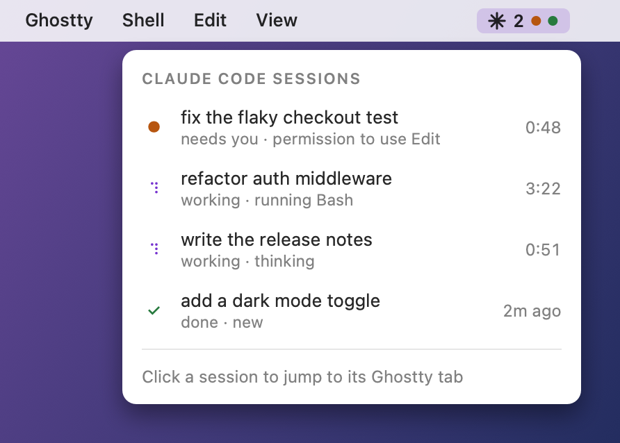

<div align="center">

# TabPulse

See which Claude Code sessions are working, waiting on you or done, right on your Ghostty tabs and in your macOS menu bar.


[](https://github.com/imtripleq/tabpulse/actions/workflows/ci.yml)
[](https://github.com/imtripleq/tabpulse/releases/latest)

[](LICENSE)

</div>

Claude Code animates its tab title only while that tab is focused. Switch away and a busy session looks the same as an idle one, so you end up clicking through tabs to check on them. TabPulse puts a spinner on every working session's Ghostty tab, shows a count in the menu bar, and marks a session that stops to ask you something with a ● on its tab and an orange dot in the menu bar.

TabPulse is a native Swift app with no Dock icon. It makes no network requests, and everything stays on your Mac. The menu bar and notifications work with any terminal. Tab spinners and click-to-jump need Ghostty 1.4 or newer.

If TabPulse saves you some tab hopping, a star on GitHub helps other people find it.

## Quick start

```sh
curl -fsSL https://raw.githubusercontent.com/imtripleq/tabpulse/main/install.sh | bash
```

When macOS asks whether TabPulse may control Ghostty, click OK. Then start `claude` and look for ✳ in your menu bar. To try another spinner or animation, open the menu and go to **Style**.

[Install](#install) has the other ways in: the Claude Code plugin, building from source and installing the zip by hand.

## What you get

<div align="center">
<picture>
  <source media="(prefers-color-scheme: dark)" srcset="assets/menu-dark.png">
  
</picture>
</div>

- A menu bar pill with a spinning ✳ and the number of sessions working. An orange dot means one needs you, and a grey ✳ means nothing is going on. A green dot means one finished while you were elsewhere. It clears when you open the menu, when that session starts working again, or, for a Ghostty tab, when you look at it.
- A spinner in front of each working Ghostty tab's title, and ● on tabs that are waiting for you. When the turn ends, the tab gets Claude's own title back.
- A session list with each session's title, what it is doing right now (`running Bash`, `permission to use Edit`) and a clock: how long the turn has run, how long it has waited for you, or how long ago it finished.
- Click a session to jump to its Ghostty tab. Sessions running anywhere else are listed but can't be clicked, and TabPulse never launches Ghostty just to look for a tab.
- A notification about ten seconds after a session finishes, unless you're looking at its Ghostty tab. The wait means a Stop hook such as `/goal` can send Claude back to work without a false alarm. You get none for a turn you stopped yourself with Esc or by rejecting a permission prompt. If an API error such as a rate limit ended the turn, it says Stopped instead of Finished. Click it to jump to the tab.
- 16 tab spinners and 24 menu bar animations to choose from. See [Styles](#styles).

## Install

### Requirements

| | |
|---|---|
| macOS | 14 Sonoma or newer, Apple Silicon or Intel |
| Claude Code | 2.1.78 or newer, the first version with the StopFailure hook event |
| Ghostty | 1.4 or newer for tab spinners and jumping to a tab, with claude running directly in the tab (not inside tmux, screen or zellij). The menu bar and notifications work with any terminal. |
| jq | ships with macOS 15 and later. On macOS 14, run `brew install jq` |

### The one-line installer

The [Quick start](#quick-start) line downloads the latest release and checks it against the SHA-256 file published with it. It puts TabPulse in `~/Applications`, adds its hooks to Claude Code's `settings.json` (saving a backup next to it first), sets the app to start at login and launches it. Run it again any time to upgrade. If `settings.json` isn't valid JSON, the installer stops before it downloads or replaces anything, so your current install keeps running.

The first time TabPulse runs while Ghostty is open, macOS asks whether it may control Ghostty. Click OK. That permission is what lets it change tab titles. macOS may also ask whether TabPulse can send notifications. Click Allow if you want a banner when a session finishes.

New Claude Code sessions show up on their own. Restart any that were already open so they pick up the hooks.

### If you use CLAUDE_CONFIG_DIR

The installer and uninstaller edit `settings.json` in `$CLAUDE_CONFIG_DIR` when it is set, and in `~/.claude` when it isn't. The installer always puts the hook script at `~/.claude/hooks/tabpulse-hook.sh` (the plugin runs its own copy), and session state always lives in `~/.claude/tabpulse/`. If you set `CLAUDE_CONFIG_DIR` only inside an alias, the installer can't see it, so run it once for each config dir:

```sh
curl -fsSL https://raw.githubusercontent.com/imtripleq/tabpulse/main/install.sh | CLAUDE_CONFIG_DIR=~/.claude-work bash
```

Do the same with the uninstaller. You can also use the plugin below, installed from inside Claude Code for each config dir.

### Hooks from the Claude Code plugin instead

If you would rather not have an installer edit `settings.json`, install only the app. With `--app-only`, the installer never touches `settings.json`:

```sh
curl -fsSL https://raw.githubusercontent.com/imtripleq/tabpulse/main/install.sh | bash -s -- --app-only
```

Then add the hooks from inside Claude Code:

```
/plugin marketplace add imtripleq/tabpulse
/plugin install tabpulse@tabpulse
```

Switching from the default install? Install the plugin first, then run the installer again without `--app-only`. It sees the plugin and removes TabPulse's old entries from `settings.json` (after saving a backup), so the hook doesn't run twice. If you run it with `--app-only` instead, it warns you that the old hooks are still there.

### Installing the zip by hand

TabPulse is ad-hoc signed and not notarized, so macOS blocks a copy you download from Releases in a browser and open yourself. The installer takes care of that. To do it by hand:

1. Unzip `TabPulse.zip` and move `TabPulse.app` to `~/Applications`.
2. Run `xattr -dr com.apple.quarantine ~/Applications/TabPulse.app`. If macOS still won't open it, use System Settings > Privacy & Security > Open Anyway.
3. Add the hooks from inside Claude Code:

   ```
   /plugin marketplace add imtripleq/tabpulse
   /plugin install tabpulse@tabpulse
   ```

Installed this way, TabPulse doesn't start at login. Add it under System Settings > General > Login Items if you want it to.

### From source

```sh
git clone https://github.com/imtripleq/tabpulse
cd tabpulse
./install.sh
```

Building needs the Xcode Command Line Tools (`xcode-select --install`). Without a clone, `curl -fsSL https://raw.githubusercontent.com/imtripleq/tabpulse/main/install.sh | bash -s -- --from-source` builds the latest source instead of downloading a release.

## Styles

<div align="center">
<picture>
  <source media="(prefers-color-scheme: dark)" srcset="assets/styles-dark.gif">
  
</picture>
</div>

Open the TabPulse menu and go to **Style**. It has a **Tab spinner** submenu and a **Menu bar** submenu, each split into sections. Your pick is saved and applies straight away. A menu bar style you pick plays for 3 seconds, even when nothing is working, so you can see it.

### Tab spinners

The spinner sits in front of a working tab's title, and next to working sessions in the menu. Sine and Typing are three characters wide.

| Glyph | Frames | Emoji | Frames |
|---|---|---|---|
| Braille (default) | `⠋ ⠙ ⠹ ⠸ ⠼ ⠴ ⠦ ⠧ ⠇ ⠏` | Moon | 🌑 🌒 🌓 🌔 🌕 🌖 🌗 🌘 |
| Bounce | `⠁ ⠂ ⠄ ⡀ ⢀ ⠠ ⠐ ⠈` | Garden | 🌱 🌿 🌷 🌻, a stage at 1, 3 and 10 min |
| Arc | `◜ ◠ ◝ ◞ ◡ ◟` | Heartbeat | 💜 💖 |
| Equalizer | `▁ ▂ ▃ ▄ ▅ ▆ ▇ █` | Magic | 🎩 🪄 💫 🐰 |
| Sparkle | `· ✢ ✳ ✶ ✻ ✽` | Monkeys | 🙊 🙈 🙉 |
| Sine | `⠊⠑⢄ ⠉⠢⣀ ⠑⢄⡠` … | Duck | 💡 🦆 💬 |
| Typing | `⡀⡀⡀ ⠄⡀⡀ ⠂⡀⡀ ⠄⠄⡀` … | Hatch | 🥚 🐣 🐥 🐤 |
| Snake | `▘ ▀ ▜ ▟ ▙ ▛ ▐ ▖` | Slots | 🍒 🔔 🍋 🍉 💎 |

### Menu bar

| Star | Signal | Playful |
|---|---|---|
| **Spin** (default): the ✳ turns | **Orbit**: a moon circles a small star | **Chomp**: munches a row of dots |
| **Breathe**: grows and fades slowly | **Comet**: a bright head with a fading tail | **Mochi**: a blushing blob that boings |
| **Hop**: bounces and squashes on landing | **Radar**: sonar rings ping out | **Kitty**: a cat bopping its head |
| **Bloom**: unfolds through `· ✢ ✳ ✶ ✻ ✽` | **Wave**: three dots doing a little wave | **Brainstorm**: a rain cloud with lightning |
| **Neon**: a purple glow that flickers now and then | **Helix**: dots twisting like DNA | **Rocket**: climbs on a flickering flame |
| **Rainbow**: turns through every colour | **Equalizer**: bars bouncing like audio levels | **Cradle**: a Newton's cradle |
| **Morph**: melts into a ring and back | **Pulse**: a heart monitor trace | **Prompt**: types a line and hits Enter |
| **Sketch**: a pen draws the ✳, then erases it | **Scanner**: a light sweeping back and forth | **Cube**: a wireframe cube turning in 3D |

With **Speed up when busy** on (the default), the menu bar moves faster as more sessions work.

TabPulse follows Reduce Motion (System Settings > Accessibility > Display). While it is on, the menu bar shows a still pose of your style. Each tab spinner holds one glyph, the one shown next to its name in the Style menu, except Garden, which still grows with the turn.

To watch every menu bar style at once, run the gallery. Press ⌘Q or close the window to quit it.

```sh
~/Applications/TabPulse.app/Contents/MacOS/TabPulse --style-gallery
```

You can also set styles from a script. Use the style's name in lowercase, then quit TabPulse (hold ⌥ and click the menu bar icon) and open it again:

```sh
defaults write dev.tabpulse.TabPulse tabStyle moon
defaults write dev.tabpulse.TabPulse barStyle chomp
defaults write dev.tabpulse.TabPulse speedsUp -bool false
```

## How it works

```
Claude Code ── hooks ──▶ tabpulse-hook.sh ──▶ ~/.claude/tabpulse/sessions/<id>.json
                                                        │
                                                        ▼ once a second
                         menu bar + session list ◀── TabPulse.app ──▶ Ghostty tab titles (AppleScript)
```

1. A small shell script runs on nine Claude Code hook events (SessionStart, UserPromptSubmit, PreToolUse, PostToolUse, PostToolUseFailure, Notification, Stop, StopFailure, SessionEnd). It writes one JSON file per session with its state, what it is doing, when the turn started, the terminal's tty and the Claude process id. It prints nothing and always exits 0, so it can't block or change a session.
2. TabPulse reads those files once a second and animates the menu bar. Using Ghostty 1.4's AppleScript support, it sets a title override on the terminal whose tty matches. It drops a session once its Claude process has exited.
3. Every ten seconds it lifts its override for a moment to read Claude's real title, which keeps the title current.

Most turns end with Claude Code's Stop hook, or with StopFailure when an API error such as a rate limit ends them. Pressing Esc fires neither, so TabPulse watches for it in other ways, in any terminal. Esc while a tool is running ends the turn straight away, because the interrupted tool reports it. Esc while Claude is thinking or writing ends it when Claude Code sends its idle notice about a minute later. In Ghostty, the title check in step 3 usually spots Claude's idle ✳ sooner, within about ten seconds. After you reject a permission prompt, the session shows needs you until that idle notice arrives. Compacting the conversation doesn't end a turn.

## Uninstall

```sh
curl -fsSL https://raw.githubusercontent.com/imtripleq/tabpulse/main/uninstall.sh | bash
```

It removes TabPulse's entries from `settings.json` first, after saving a backup. If jq is missing or `settings.json` isn't valid JSON, it stops there and removes nothing. Otherwise it quits TabPulse and deletes the app, the login item, the hook script and the `~/.claude/tabpulse` state folder.

Restart any Claude Code sessions that are still open, since they keep calling the old hooks until then. If you installed for a `CLAUDE_CONFIG_DIR`, run the uninstaller the same way for each config dir; it keeps the shared hook script while `~/.claude/settings.json` still uses it. If you used the plugin, also run `/plugin uninstall tabpulse@tabpulse`.

## Troubleshooting

**The menu says "Allow TabPulse to control Ghostty".** You declined the permission prompt. Click that item, or open System Settings > Privacy & Security > Automation and turn on Ghostty under TabPulse.

**The menu says Claude Code hooks aren't installed.** TabPulse found no TabPulse hooks or plugin in `settings.json`, and no session has written a file yet. Run the installer, or add the plugin. If your settings live in a `CLAUDE_CONFIG_DIR` that TabPulse can't see, the message goes away once the first session starts.

**macOS says TabPulse can't be opened or is damaged.** That happens when you open a copy downloaded in a browser, because TabPulse isn't notarized. Run `xattr -dr com.apple.quarantine ~/Applications/TabPulse.app`, or use System Settings > Privacy & Security > Open Anyway. The installer does this for you.

**The installer says settings.json is not valid JSON.** It stopped before changing anything. Fix the file (jq's error above that line gives the line and column) and run the installer again.

**No notification when a session finishes.** Check System Settings > Notifications > TabPulse, and that no Focus mode such as Do Not Disturb is on. TabPulse also skips the notification when that session's Ghostty tab is the one in front of you, when you stopped the turn yourself, and when you open the menu before it's due. The banner waits about ten seconds after the turn ends, because a Stop hook such as `/goal` can send Claude straight back to work.

**A session has no tab spinner.** Tab spinners and jumping to a tab only work when claude runs directly in a Ghostty tab. Inside tmux, screen or zellij, or in another terminal, TabPulse can't tell which Ghostty tab the session is in, so its row in the menu can't be clicked either. The menu bar and notifications still work there.

**A session still says working after I pressed Esc.** If no tool was running when you pressed Esc, TabPulse finds out from Claude Code's idle notice, which arrives about a minute later. In a Ghostty tab it usually notices within ten seconds.

**A session says needs you after I rejected a permission prompt.** It stays that way until Claude Code's idle notice arrives, about a minute later, in any terminal.

**The finished banner says Script Editor and opens it when clicked.** macOS wouldn't let TabPulse send its own notifications, which happens on some Macs for apps that aren't notarized, so TabPulse sent the banner through AppleScript instead. Click the session in the menu bar to jump to its tab.

**A session doesn't show up.** Sessions that were already open when you installed may need a restart to pick up the hooks. Send a prompt and check that a file appears in `~/.claude/tabpulse/sessions/`.

**The tab title flickers every ten seconds.** That's TabPulse reading Claude's real title (step 3 in How it works), so Claude's own ◐ shows for a moment.

**A spinner stayed on a tab after TabPulse crashed.** Start TabPulse again and it hands back any titles it left behind.

**macOS asked for permission again after an update.** Release builds are signed ad hoc, so macOS treats each version as a new app.

**Where is Quit?** Hold ⌥ (Option) while you click the menu bar icon.

## Roadmap

Any of these would make a good first contribution:

- Tab spinners for iTerm2, WezTerm, kitty and Terminal.app
- Notarized builds and a Homebrew cask
- A small settings window (start at login, hide finished sessions)

New tab spinners and menu bar styles are welcome too. [CONTRIBUTING.md](CONTRIBUTING.md#adding-a-style) shows how to add one.

## Contributing

Bug reports and pull requests are welcome. [CONTRIBUTING.md](CONTRIBUTING.md) covers setup, tests and the project layout.

## License

[MIT](LICENSE). TabPulse is a community project and is not affiliated with Anthropic or Ghostty.
